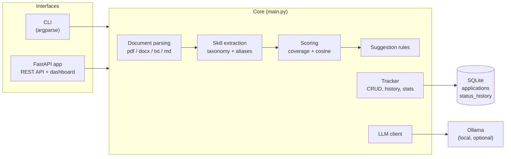

# ResumeFit

[](https://github.com/shekharsanskar9/AgentResume/actions/workflows/tests.yml)


**Score your resume against any job description, find out exactly what to fix, and track every application from _wishlist_ to _offer_.**

ResumeFit is a Python tool with a CLI and a FastAPI web dashboard. It finds the skills and keywords a job description asks for that your resume is missing, gives you specific suggestions, and can ask a local LLM to rewrite your bullet points. It stores each job you save with its JD, so you can re-score all of them when your resume changes and see which skills you're missing most often.

```
=== ResumeFit report ===
Overall match   [##############----------------] 46%
Skill coverage  55%   |   Text similarity 28%

Weak match - tailor the resume heavily or prioritise other roles.

Matched skills (6): Docker, FastAPI, LLMs, Python, RAG, Vector databases
Missing skills (5): AWS, CI/CD, Kubernetes, LangChain, REST APIs
JD keywords not in your resume: engineer, applications, pipelines, collaborate, product, stakeholders

=== Suggestions ===
 1. The JD asks for skills your resume doesn't mention: AWS, CI/CD, Kubernetes, LangChain,
    REST APIs. Add the ones you have actually used to your Skills section AND to a project
    or experience bullet - a bare skills list carries less weight.
 2. These matching skills appear only once in your resume. Show them in action in a
    bullet: Docker, FastAPI, LLMs, RAG, Vector databases.
 3. Only 2 of 6 bullet points contain a number. Add metrics (latency, accuracy, users, %
    improvement, dataset size) where you can.
 4. Replace weak phrases with action verbs (built, designed, reduced, shipped):
    "responsible for", "worked on", "helped with".
```

<!-- Add a screenshot of the dashboard here, e.g.  -->

---

## Contents

- [Why ResumeFit](#why-resumefit)
- [Features](#features)
- [Architecture](#architecture)
- [Quick start](#quick-start)
- [CLI usage](#cli-usage)
- [Web dashboard and REST API](#web-dashboard-and-rest-api)
- [How the score works](#how-the-score-works)
- [Configuration](#configuration)
- [Extending ResumeFit](#extending-resumefit)
- [Testing and CI](#testing-and-ci)
- [Project structure](#project-structure)
- [Known limitations](#known-limitations)
- [Roadmap](#roadmap)
- [Contributing](#contributing)
- [License](#license)

---

## Why ResumeFit

Most resume checkers give you one score and stop there. ResumeFit is built around the whole job search:

- **It tells you what to do next.** You get a list of fixes, not just a percentage.
- **It keeps its data.** Every saved job keeps its full JD, so your tracker becomes a dataset you can re-score, search and analyse.
- **It's private by default.** Resumes, JDs and the tracker never leave your machine. AI rewrites run on a local Ollama model, with no API keys.
- **It's light.** The core CLI runs on the Python standard library alone. PDF/DOCX reading, the web app and the LLM are optional add-ons.

---

## Features

### Matching engine
| Capability | Details |
|---|---|
| **Match score** | 70% skill coverage + 30% text similarity (cosine over unigrams + bigrams) |
| **Skill extraction** | Built-in list of 85 skills and 197 aliases (`k8s` → Kubernetes, `sklearn` → scikit-learn, `lora` → Fine-tuning). Matches whole terms only and handles `C++`, `C#`, `Node.js`, `CI/CD` and plurals |
| **Multi-JD ranking** | `rank` scores one resume against a folder of JDs, so you know which jobs to apply to first |
| **Tailoring suggestions** | Missing skills, skills mentioned only once, JD wording to reuse, and resume checks: length, contact details, bullets with numbers, weak phrases, first-person words |
| **AI bullet rewrites** | Optional, through a local [Ollama](https://ollama.com) model. The prompt tells the model never to invent experience and to write `[add metric]` instead of making up numbers |
| **File formats** | `.pdf`, `.docx` (including text inside tables), `.txt`, `.md`, or pasted text |

### Application tracker
| Capability | Details |
|---|---|
| **Pipeline** | `wishlist` → `applied` → `oa` → `interview` → `offer` (plus `rejected`, `withdrawn`) |
| **Status timeline** | Every status change is stored with its date in a separate `status_history` table |
| **Funnel analytics** | Applied → responded → interview → offer, worked out from the history. An interview that later ended in a rejection still counts as an interview |
| **Score vs outcome** | Average match score of jobs that responded compared with jobs that didn't |
| **Follow-ups** | Follow-up dates (`+5`, `tomorrow`, `YYYY-MM-DD`) and a `remind` command for overdue follow-ups and applications idle for N days |
| **Skill-gap report** | The skills missing most often across all saved jobs, i.e. what to learn next |
| **Rescore** | Re-score every saved job against a new version of your resume, showing the score change for each |
| **CSV export / import** | Every row is checked before anything is written, so a bad file never leaves a half-finished import |
| **Schema migrations** | Databases from older versions are upgraded automatically when opened |

### Web dashboard
- Upload or paste a resume, paste a JD, and see the score, skill chips and suggestions
- Save the job in one click, then change its status, add notes or delete it from the table
- Pipeline funnel, follow-up list, skill-gap chart, search and filter, CSV download
- REST API with interactive OpenAPI docs at `/docs`

---

## Architecture

All the logic lives in one core module. The CLI and the web app are thin layers on top of it and share the same SQLite database.



**Design choices**

- **One core, two interfaces.** Anything that works in the CLI also works over HTTP. The API is a thin layer that turns `ResumeFitError` into HTTP 400 and `NotFoundError` into 404.
- **The JD is stored with each application.** This is what makes `rescore` and `gaps` possible, and it leaves room for analytics later.
- **History is append-only.** The funnel is built from `status_history`, not the current status, so funnel numbers stay correct after a rejection.
- **Optional dependencies are imported lazily.** `pypdf`, `python-docx`, FastAPI and Ollama are only needed for the features that use them.

---

## Quick start

Requires **Python 3.9+**.

```bash
git clone https://github.com/shekharsanskar9/AgentResume.git
cd AgentResume
pip install -r requirements.txt     # or install only what you need, see below

python main.py match resume.pdf jd.txt
```

| You want to... | Install |
|---|---|
| Use the CLI with .txt / .md files | nothing (standard library only) |
| Read .pdf / .docx resumes | `pip install pypdf python-docx` |
| Run the web dashboard | `pip install fastapi uvicorn python-multipart` |
| Run the web API tests | `pip install httpx` |
| Get AI rewrites | [Ollama](https://ollama.com), then `ollama pull qwen2.5:7b` |

---

## CLI usage

### Match, rank and get suggestions

```bash
python main.py match resume.pdf jd.txt                 # score one JD (file, or JD text in quotes)
python main.py match resume.pdf jd.txt --json          # JSON output for scripts

python main.py rank resume.pdf jds/                    # rank every JD file in a folder
python main.py rank resume.pdf amgen.txt boeing.txt

python main.py suggest resume.pdf jd.txt               # tailoring tips
python main.py suggest resume.pdf jd.txt --llm         # + AI bullet rewrites (Ollama)
python main.py suggest resume.pdf jd.txt --llm --model llama3.1:8b
```

### Save and track

```bash
# score and save in one step (the JD is stored, so rescore and gaps work later)
python main.py match resume.pdf jd.txt --save --company Amgen --role "AI Engineer" --status applied --follow-up +5

# add manually (optionally with a JD and resume to score it)
python main.py add Boeing "Software Engineer" --status applied --link https://careers.example.com/123
python main.py add Rupeek "Technocrat Intern" --jd rupeek_jd.txt --resume resume.pdf

python main.py list                                    # all applications
python main.py list --status interview                 # filter by status
python main.py list -q boeing                          # search company / role / notes
python main.py show 2                                  # details + status timeline

python main.py update 2 --status oa --add-note "OA on Monday, 90 min" --follow-up +3
python main.py update 2 --follow-up none               # clear the follow-up date
python main.py delete 2                                # asks first; --yes to skip
```

### Stay on top of things

```bash
python main.py remind                  # follow-ups due + active applications idle for 7+ days
python main.py remind --days 10
python main.py gaps                    # skills missing most often across saved jobs
python main.py rescore resume_v2.pdf   # re-score all saved jobs after editing your resume
python main.py stats                   # funnel, response rate, average scores
python main.py export applications.csv
python main.py import applications.csv
```

Sample `stats` output:

```
Total applications: 6
  applied      2  #######-------------
  interview    1  ###-----------------
  rejected     3  ##########----------

Funnel (ever reached): applied 6 -> responded 3 -> interview 2 -> offer 0
Response rate (OA/interview/offer): 50%   |   Interview rate: 33%
Average match score: 58%
  ... for jobs that responded: 71%   |   no response: 45%
```

Dates accept `YYYY-MM-DD`, `today`, `tomorrow`, or `+N` (N days from today). Most commands take `--json`, so the CLI can be scripted or piped into other tools.

### Command reference

| Command | Description | Key options |
|---|---|---|
| `match <resume> <jd>` | Score a resume against a JD | `--json`, `--save`, `--company`, `--role`, `--status`, `--link`, `--notes`, `--follow-up` |
| `rank <resume> <jd...>` | Rank many JDs (files / folders) | `--json` |
| `suggest <resume> <jd>` | Tailoring tips | `--llm`, `--model`, `--json` |
| `add <company> <role>` | Add an application | `--status`, `--score`, `--link`, `--notes`, `--follow-up`, `--jd`, `--resume` |
| `list` | Show applications | `--status`, `-q/--search`, `--json` |
| `show <id>` | Details + timeline | `--json` |
| `update <id>` | Update an application | `--status`, `--notes`, `--add-note`, `--link`, `--score`, `--follow-up` |
| `delete <id>` | Delete an application | `--yes` |
| `remind` | What needs a follow-up | `--days`, `--json` |
| `gaps` | Most common missing skills | `--top`, `--json` |
| `rescore <resume>` | Re-score saved jobs | `--id` |
| `stats` | Pipeline summary | `--json` |
| `export [path]` | Export to CSV (`-` = stdout) | |
| `import <path>` | Import from CSV | |

Run `python main.py <command> -h` for full help.

---

## Web dashboard and REST API

```bash
uvicorn app:app --reload
# dashboard: http://127.0.0.1:8000      API docs: http://127.0.0.1:8000/docs
```

The CLI and the web app share the same `applications.db`.

| Method | Endpoint | Description |
|---|---|---|
| `POST` | `/api/match` | multipart: `jd`, `resume` (file, max 5 MB) or `resume_text`, `use_llm`, `model` → report + tips |
| `GET` | `/api/applications?status=&q=` | list / filter / search |
| `GET` | `/api/applications/{id}` | details + status history |
| `POST` | `/api/applications` | create (`company`, `role`, `status`, `score`, `link`, `notes`, `jd`, `missing_skills`, `follow_up`) |
| `PATCH` | `/api/applications/{id}` | update status / notes / `add_note` / link / score / follow-up |
| `DELETE` | `/api/applications/{id}` | delete |
| `GET` | `/api/stats` | funnel and averages |
| `GET` | `/api/reminders?days=7` | applications that need a follow-up |
| `GET` | `/api/gaps?top=10` | most common missing skills |
| `GET` | `/api/export.csv` | download the tracker |

Errors come back as `{"detail": "..."}`: **400** for bad input, **404** for an unknown id, **422** for schema validation errors.

---

## How the score works

1. **Skill extraction.** Both texts are lowercased and scanned for every alias in the `SKILLS` dictionary. Matching uses whole terms only (`java` doesn't match inside `javascript`) and allows plurals (`microservices`, `REST APIs`).
2. **Skill coverage** = matched JD skills ÷ JD skills.
3. **Text similarity.** Cosine similarity of unigram and bigram counts, with stopwords removed. A resume and a JD rarely score above about 0.35, so the raw value is divided by 0.35 and capped at 1.0.
4. **Overall score** = `round(100 × (0.7 × coverage + 0.3 × similarity))`. If the JD mentions no known skills, the score is the text similarity alone.

| Score | Verdict |
|---|---|
| 75%+ | Strong match. Apply, and use the JD's wording in your bullet points. |
| 50–74% | Decent match. Add the missing skills you really have before applying. |
| < 50% | Weak match. Tailor the resume heavily or focus on other roles. |

> Only add a "missing skill" to your resume if you can talk about it in an interview. The same goes for the AI rewrites: check every line.

---

## Configuration

| Environment variable | Default | Purpose |
|---|---|---|
| `RESUMEFIT_DB` | `applications.db` next to `main.py` | Path to the SQLite database |
| `RESUMEFIT_MODEL` | `qwen2.5:7b` | Default Ollama model for `--llm` |
| `OLLAMA_URL` | `http://localhost:11434` | Ollama server address |

---

## Extending ResumeFit

The code is organised around a few small functions, so each part can be changed or replaced on its own.

| To change... | Edit | Notes |
|---|---|---|
| **Skills and aliases** | `SKILLS` in `main.py` | Key = display name, value = list of lowercase aliases |
| **Filler words** | `STOPWORDS` | Words ignored by similarity and keyword suggestions |
| **Score weighting** | `match()` | The `0.7` / `0.3` split and the `0.35` similarity cap |
| **Resume checks** | `resume_checks()` | Each check adds one tip string, so a new rule is a few lines |
| **JD-specific tips** | `suggest()` | Add rules that compare the resume with the JD |
| **File formats** | `read_text()` | Add a branch for a new suffix and add it to `RESUME_SUFFIXES` |
| **LLM backend** | `llm_suggestions()` | Uses the standard library only (`urllib`), so it's easy to point at any HTTP model server |
| **Statuses / funnel** | `STATUSES`, `ACTIVE_STATUSES`, `RESPONSE_STATUSES` | Used by validation, reminders and stats |
| **API endpoints** | `app.py` | Each endpoint calls one core function |

---

## Testing and CI

```bash
python -m unittest discover -s tests -v      # or: pytest
```

40 tests cover skill extraction, scoring, ranking, suggestions, the tracker (history, reminders, gaps, rescore, CSV round trip, migrating old databases), the CLI and the web API. Tracker tests each get their own temporary database and a fixed "today", so results are the same on every run. GitHub Actions runs the suite on Python 3.9 and 3.12 for every push and pull request.

---

## Project structure

```
AgentResume/
├── main.py                   # core: parsing, matching, suggestions, tracker, CLI
├── app.py                    # FastAPI web app + single-page dashboard
├── tests/
│   └── test_resumefit.py     # unit, CLI and API tests
├── .github/workflows/
│   └── tests.yml             # CI on Python 3.9 and 3.12
├── requirements.txt
├── LICENSE
├── README.md
└── applications.db           # created on first use (git-ignored)
```

---

## Known limitations

Knowing the limits helps decide what to build next:

- **Keyword-based matching.** Related skills that aren't aliases of each other ("PyTorch" vs "deep learning framework") don't count yet. Semantic matching is the main item on the roadmap.
- **English only.** Stopwords, weak phrases and skill aliases are all English.
- **Single user, local.** There is no authentication, and SQLite allows one writer at a time. That's fine on your laptop, but not for a shared deployment yet.
- **The LLM call is synchronous.** A rewrite request waits until Ollama finishes, which can take a minute on a CPU.
- **Scanned PDFs** have no text layer, so they can't be read. Export the resume to .docx or .txt instead.

---

## Roadmap

### Done
- [x] FastAPI web app with resume upload and a dashboard
- [x] Optional local LLM bullet rewrites (Ollama)
- [x] CSV export and import
- [x] Reminders for overdue follow-ups and idle applications
- [x] Status timeline, skill-gap report, rescoring, multi-JD ranking

### Next: modular package
- [ ] Split `main.py` into a `resumefit/` package: `parsing`, `skills`, `scoring`, `suggestions`, `tracker`, `llm`, `cli`, `api`
- [ ] Move the skill list into a data file (`skills.yaml`) so skills can be added without touching code
- [ ] A common interface for scorers, so keyword and semantic scoring can run side by side
- [ ] Packaging with `pyproject.toml` and a `resumefit` command on the PATH
- [ ] Lint and type checks (`ruff`, `mypy`) in CI, plus a coverage report

### Smarter matching
- [ ] Semantic matching with sentence embeddings, so related skills count too
- [ ] Section-aware parsing (skills vs experience vs projects), so a skill used in a bullet weighs more than a bare list entry
- [ ] Separate "required" and "nice to have" JD skills, weighted differently
- [ ] Explain each score point by point in the report

### Scale and deployment
- [ ] Database layer with SQLAlchemy + Alembic migrations, with PostgreSQL as an option
- [ ] User accounts and auth, so one deployment can serve several people
- [ ] Background jobs for LLM rewrites and bulk rescoring, so API requests return straight away
- [ ] Cache parsed resumes and skill extraction results
- [ ] Dockerfile and `docker-compose.yml` (API + database + Ollama)

### Integrations
- [ ] Browser extension to save a JD straight from a job board
- [ ] Calendar reminders for follow-ups and interviews
- [ ] Support for more LLM backends behind the same interface

---

## Contributing

Issues and pull requests are welcome.

1. Fork the repo and create a branch: `git checkout -b feature/my-change`
2. Add or update tests in `tests/` for what you change
3. Run `python -m unittest discover -s tests -v` and make sure everything passes
4. Open a pull request that explains what changed and why

Good first contributions: adding skills and aliases, new resume checks, or more file formats.

---

## License

Released under the [MIT License](LICENSE).

## Author

**Sanskar Shekhar**, B.Tech CSE, BIT Mesra
[GitHub](https://github.com/shekharsanskar9) · [LinkedIn](https://linkedin.com/in/sanskar-shekhar)
